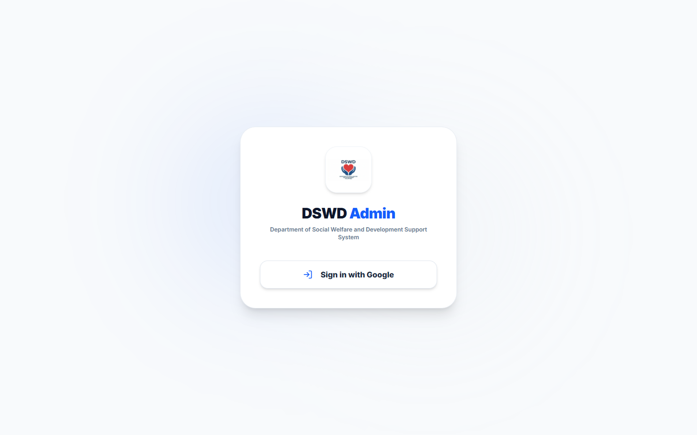

**REACT · TYPESCRIPT · FIREBASE**

# Citizen Services · Admin Portal

### One workspace for the people behind citizen support.

[Explore the project](#project-overview) · [Documentation](#project-documentation) · [Contact the developer](mailto:louise.catala24@gmail.com)

  

<em>Actual local sign-in screen. No administrator session or citizen records are shown.</em>

## Project overview

A project interface for organizing citizen-service administration, with dedicated views for registered users, appointments, benefits, announcements, contacts, and a dashboard. The goal is to make these related tasks easier to find in one workspace.

| At a glance | What it means |
| --- | --- |
| **Citizen records** | Dedicated user-list view |
| **Service coordination** | Appointment queue and benefits management |
| **Communication** | Announcement and contact-management views |

## See the workflow in the source

Google sign-in and administrator checks control entry to the interface. Explore the view components below to see how the workspace is organized. This is a project showcase; the README does not establish official agency endorsement or production readiness.

[Explore the admin views](src/views) · [View the application flow](src/App.tsx) · [Review access handling](src/lib/AuthContext.tsx)

## Project documentation

<strong>Open the original project notes, files, and setup instructions</strong>

# Run and deploy your AI Studio app

This contains everything you need to run your app locally.

View your app in AI Studio: https://ai.studio/apps/3b0605f3-db7a-4d94-bb90-98319e804d48

## Run Locally

**Prerequisites:**  Node.js

1. Install dependencies:
   `npm install`
2. Set the `GEMINI_API_KEY` in [.env.local](.env.local) to your Gemini API key
3. Run the app:
   `npm run dev`

---

## License and Support

Copyright © 2026 Orland Louise Catala. All rights reserved for my original work, except where an existing license states otherwise. Third-party materials remain subject to their respective licenses.

Please do not copy, modify, redistribute, sell, or claim my original project files as your own without my permission.

I’m a student developer with limited financial resources, and these projects represent many hours of effort. Please respect and support my work. If you would like a copy of the project files, contact me at **[louise.catala24@gmail.com](mailto:louise.catala24@gmail.com)** to discuss a cheap price. Your support helps me continue studying and creating.
